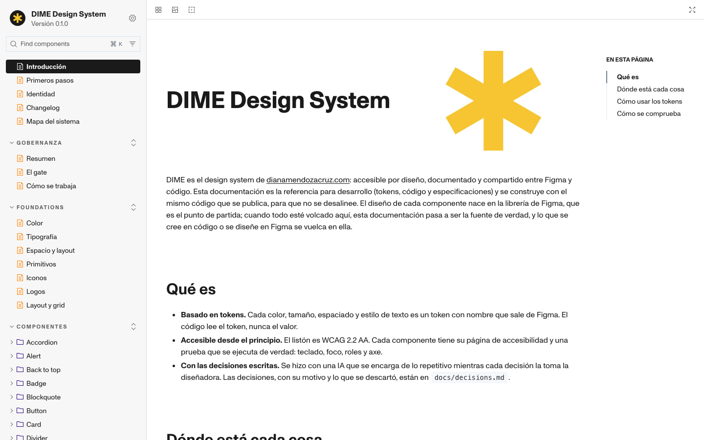

# DIME Design System

[](https://github.com/dmendozacruz/dime/actions/workflows/gate.yml)

**[Storybook](https://dmendozacruz.github.io/dime/)** · **[dianamendozacruz.com](https://dianamendozacruz.com)**

[](https://dmendozacruz.github.io/dime/)

DIME is the design system behind [dianamendozacruz.com](https://dianamendozacruz.com), Diana Mendoza's
portfolio. Figma is the starting point; once everything is in Storybook, Storybook becomes the source of truth.

The brand is an asterisk, which signals that there is something more: an extra detail that did not fit in
the main text and is worth reading. DIME grows from the same idea: accessibility, documentation and code are
part of the design from the start, not added afterwards.

It is built around three ideas:

- **Token-first.** Every colour, size, space and type style is a named token generated from Figma
  (`npm run tokens`), never written by hand. Code reads the tokens, not the values.
- **Accessibility-first.** The bar is WCAG 2.2 AA. Every story runs axe and, where it is interactive, a
  keyboard test. A change does not ship unless the gate passes.
- **Decisions on the record.** It was built with an AI assistant doing the repetitive work while every
  decision stayed with the designer. The decisions, with their reasons and what was discarded, are in
  [`docs/decisions.md`](./docs/decisions.md).

> **Version 0.1.0.** Complete enough to read and run. Manual testing with VoiceOver (desktop) and TalkBack
> (mobile) is still in progress; the automated checks run on every change.

## The identity, in a few decisions

- **One typeface, four weights:** ABC Monument Grotesk (Light, Regular, Medium, Bold). The hierarchy comes
  from size and weight, never from changing typeface.
- **Black, white and one accent:** the brand black (`--color-background-brand`), white and greys, with a
  yellow accent (`--color-base-accent`) used sparingly to highlight.
- **A double focus ring with a 2 px gap:** 2 px gap, 2 px dark ring, 2 px yellow ring. It reads on any
  background (decision D-027).
- **One radius:** the 100 px pill, with no token (decision D-013). Everything else has square corners.
- **Always tokens:** no colour, type size or spacing is written by hand.

The full story is on the [Identity page](https://dmendozacruz.github.io/dime/?path=/docs/identidad--docs).

## What is inside

- **Foundations:** colour, typography, spacing and layout tokens, primitives, icons and logos.
- **16 components:** Accordion, Alert, Back to top, Badge, Blockquote, Button, Card, Divider, Input, Link,
  Nav Footer, Nav Header, Process list, Skip nav, Tabs and Tooltip. Nav Header and Nav Footer combine the
  others and respond to the width of their container.
- **Three documentation pages per component** in Storybook (*Uso*, *Código* and *Accesibilidad*), plus
  the interactive examples (*Ejemplos*), with a keyboard test on the interactive ones.
- **Web components in light DOM** for what has behaviour, so they keep global styles and ARIA references;
  plain `dime-` CSS classes on native elements for what does not. See decision D-017.

## Install

Not on npm yet. Install it straight from GitHub:

```bash
npm install --save-dev github:dmendozacruz/dime
```

Or copy the `tokens/` and `components/` folders into your project.

## Quickstart

```html
<link rel="stylesheet" href="node_modules/dime/tokens/tokens.css" />
<link rel="stylesheet" href="node_modules/dime/tokens/typography.css" />
<link rel="stylesheet" href="node_modules/dime/components/index.css" />
<script type="module" src="node_modules/dime/components/index.js"></script>
```

```css
.my-card {
  background: var(--color-background-default);
  color: var(--color-content-default);
  padding: var(--space-4);
}
```

Use the token, not the resolved value. `tokens/typography.css` has one class per Figma text style
(`.text-body-l-regular`, `.text-heading-m-bold`…). `tokens/tokens.json` has the same tokens in the W3C
Design Tokens format. Components with behaviour are web components (`<dime-tabs>`); the rest are `dime-`
classes on native elements (`<a class="dime-link">`).

## Token architecture

```
Figma library (variables, text styles, shadows)
        │  dump
tokens/source/figma.json              never edited by hand
        │
scripts/build-tokens.mjs ──▶ tokens/tokens.css  typography.css  tokens.json
                                       │              (generated)
                                       ▼
                          Storybook: Foundations and components
                                       │
                                       ▼
                           the website (next step)
```

Primitive tokens (`neutral/900`, `space/6`) say what a value is; semantic tokens (`content/default`,
`border/subtle`) say what it is for and point to a primitive. Components use only the semantic ones.

## Run it

```bash
npm install
npm run storybook        # http://localhost:6006
```

| Command | What it does |
|---|---|
| `npm run tokens` | Regenerates the tokens from the Figma dump. |
| `npm run storybook` | Storybook in development. |
| `npm run build-storybook` | Builds the static site into `storybook-static/`. |
| `npm run test` | Runs every story as a test: its keyboard and focus checks, and axe. |
| `npm run gate` | The whole check: tokens match Figma, every component has its pages, stories pass, Storybook builds. |

### The gate

`npm run gate` decides whether work ships, and CI runs it on every pull request. It runs, in order:

1. **Tokens:** the generated files match `tokens/source/figma.json`. A hand edit would be caught here.
2. **Structure:** every component has its three pages, its Figma node and stories with axe set to error.
3. **Stories:** each story is run in a real browser: interaction tests (keyboard, focus, roles, states)
   and axe on every story.
4. **Build:** Storybook builds without errors.

### Typography

ABC Monument Grotesk is a commercial typeface, so the `.woff2` files are **not** in this repository
(see decision D-008 and `.gitignore`). The tokens ask for it by name and fall back to Helvetica Neue or
Arial, so everything else works the same. If you have the files, put them in `public/fonts/` using the
names that appear in `.storybook/fonts.css`.

## Docs

- **[Storybook](https://dmendozacruz.github.io/dime/)**: the documentation site. Foundations, the governance
  section, the system map and the 16 components, each with its usage, code and accessibility pages.
- [`docs/decisions.md`](./docs/decisions.md): why the system is the way it is, decision by decision.
- [`docs/work/`](./docs/work/README.md): working notes per component, with sources and what was checked.
- [`CHANGELOG.md`](./CHANGELOG.md): what changed in each version.
- [`AGENTS.md`](./AGENTS.md): the rules for AI assistants working in this repository.

## Where things are

| Folder | What it contains |
|---|---|
| `tokens/source/figma.json` | Dump of the variables, text styles and shadows from Figma. Not edited by hand. |
| `tokens/tokens.css`, `typography.css`, `tokens.json` | Generated with `npm run tokens`. |
| `tokens/descriptions.es.json` | Usage text of each semantic token, shown in Storybook. |
| `scripts/` | The token generator and the gate checks. |
| `components/` | The 16 components: CSS, web components (`*.js`), stories and the pages of each one. |
| `docs/` | Storybook pages (MDX): introduction, system map and Foundations. |
| `docs/blocks/` | Reusable blocks for those pages (colour swatches, copy button, component header…). |
| `docs/decisions.md` | The numbered decision log (D-001…), with the reason for each. |
| `docs/work/` | Working notes for each component: sources, decisions and what was checked. Start at its `README.md`. |
| `CHANGELOG.md` | Every change, by version. |
| `AGENTS.md`, `CONTEXT.md`, `.agents/` | How the AI assistant is expected to work in this repository, the shared vocabulary, and its skills. |
| `.github/workflows/` | The gate on every pull request, and the Storybook deployment to GitHub Pages. |

## A note on language

The documentation (Storybook pages, decisions and notes) is written in **Spanish**, by design
(decision D-002). Code, class names and this README are in English.

## Licence

The code is public to read and learn from. There is no licence for reuse: all rights are reserved.

## Third-party assets

The typeface (ABC Monument Grotesk) and the client logos in `public/logos/` belong to their owners.
They are shown to document the system and are not offered for reuse.
